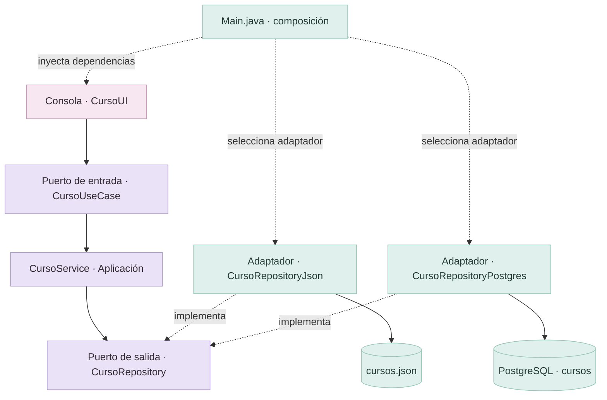

<div align="center">

# ✦ Sistema de Gestión Académica

### Arquitectura Hexagonal · Puertos & Adaptadores

**Un núcleo de negocio, múltiples formas de almacenar información.**

[](https://www.java.com/)
[](https://maven.apache.org/)
[](https://www.postgresql.org/)
[](https://github.com/google/gson)

**Laboratorio 04 · Arquitectura de Software · 2026-II**  
Universidad Nacional de San Cristóbal de Huamanga · Ingeniería de Sistemas

[Arquitectura](#-arquitectura-del-sistema) · [Funcionalidades](#-funcionalidades) · [Instalación](#-instalación-y-ejecución) · [Persistencia](#-persistencia-json-y-postgresql) · [Autor](#-autor)

</div>

---

## 🌿 Sobre el proyecto

Este laboratorio implementa un **sistema académico de consola en Java**, organizado con el enfoque de **Arquitectura Hexagonal (Ports & Adapters)**. Gestiona estudiantes y cursos mediante casos de uso, contratos de repositorio y adaptadores intercambiables.

El propósito es **separar las reglas de la aplicación de los detalles técnicos**: una misma lógica de cursos puede trabajar con **archivos JSON o PostgreSQL**, seleccionando el adaptador correspondiente desde `Main.java`, sin reescribir el servicio ni la interfaz de consola.

> **Idea central:** la aplicación define qué necesita; los adaptadores resuelven cómo se realiza.

## ✧ Tecnologías

| Tecnología | Uso en el proyecto |
| :-- | :-- |
| **Java 25** | Modelos, puertos, servicios y menú de consola |
| **Apache Maven** | Construcción y gestión de dependencias |
| **Gson** | Lectura y escritura de datos JSON |
| **PostgreSQL 18** | Almacenamiento relacional (entorno utilizado en las pruebas) |
| **JDBC** | Comunicación de Java con PostgreSQL |
| **VS Code** | Desarrollo y ejecución |
| **Git / GitHub** | Versionado incremental de cambios |

## 🧩 Arquitectura del sistema



**Responsabilidades principales:**

| Componente | Responsabilidad |
| :-- | :-- |
| `CursoUI` | Recibe las opciones del usuario desde la consola. |
| `CursoUseCase` | Expone las operaciones de entrada. |
| `CursoService` | Ejecuta el CRUD sin decidir dónde se almacena la información. |
| `CursoRepository` | Establece el contrato de persistencia. |
| `CursoRepositoryJson` | Guarda y recupera cursos desde JSON. |
| `CursoRepositoryPostgres` | Guarda y recupera cursos mediante JDBC. |
| `Main` | Construye los objetos y conecta los puertos con sus adaptadores. |

La gestión de **estudiantes** también dispone de un puerto de entrada, un servicio y adaptadores de persistencia JSON/PostgreSQL.

## 📂 Estructura principal

```text
SistemaGestionAcademica/
├── data/
│   ├── cursos.json
│   └── estudiantes.json
├── database/
│   └── 01_crear_tabla_cursos.sql
├── src/main/java/com/academico/
│   ├── application/
│   │   ├── port/in/
│   │   │   ├── CursoUseCase.java
│   │   │   └── EstudianteUseCase.java
│   │   └── service/
│   │       ├── CursoService.java
│   │       └── EstudianteService.java
│   ├── domain/
│   │   ├── model/
│   │   │   ├── Curso.java
│   │   │   └── Estudiante.java
│   │   └── repository/
│   │       ├── CursoRepository.java
│   │       └── EstudianteRepository.java
│   ├── infrastructure/adapter/out/persistence/
│   │   ├── CursoRepositoryJson.java
│   │   ├── CursoRepositoryPostgres.java
│   │   ├── EstudianteRepositoryJson.java
│   │   └── EstudianteRepositoryPostgres.java
│   ├── presentation/
│   │   ├── CursoUI.java
│   │   └── EstudianteUI.java
│   └── Main.java
├── pom.xml
└── README.md
```

> La estructura representa la versión desarrollada durante el laboratorio. Si tu clon aún no incluye los cambios locales recientes, súbelos antes de comparar las rutas con GitHub.

## ✅ Funcionalidades

| Módulo | Operaciones | Estado documentado |
| :-- | :-- | :-- |
| **Cursos · JSON** | Registrar, listar, actualizar y eliminar | CRUD probado desde consola |
| **Cursos · PostgreSQL** | Persistencia mediante JDBC | Conexión y registro verificados; comprobación completa del CRUD pendiente |
| **Estudiantes** | Gestión desde consola | Módulo integrado; requiere verificar su entorno PostgreSQL |

La aplicación ofrece un menú principal y un submenú para cursos. La persistencia se decide desde el punto de composición, no dentro de los casos de uso.

## 🚀 Instalación y ejecución

### Requisitos

- **JDK 25** y **Maven** disponibles desde la terminal.
- **PostgreSQL** en ejecución, para utilizar los adaptadores JDBC.
- La base de datos y la tabla `cursos` creadas en PostgreSQL.

### 1 · Clonar

```powershell
git clone https://github.com/paulbellido0990/Labo4_Arqui_Hexagonal.git
cd Labo4_Arqui_Hexagonal
```

> Ejecuta los comandos Maven desde la carpeta que contiene `pom.xml`. Si el proyecto está dentro de otra carpeta llamada `SistemaGestionAcademica`, entra primero en ella.

### 2 · Preparar PostgreSQL

Crea una base de datos denominada `sistema_gestion_academica` si aún no existe y ejecuta en pgAdmin el contenido del script `database/01_crear_tabla_cursos.sql`.

El esquema de cursos utilizado es:

```sql
CREATE TABLE IF NOT EXISTS cursos (
    id INTEGER PRIMARY KEY,
    nombre VARCHAR(150) NOT NULL,
    creditos INTEGER NOT NULL,
    CONSTRAINT chk_cursos_creditos CHECK (creditos > 0)
);
```

### 3 · Configurar conexión de forma local

En **PowerShell**, para la sesión actual:

```powershell
$env:DB_URL  = "jdbc:postgresql://localhost:5432/sistema_gestion_academica"
$env:DB_USER = "postgres"
$env:DB_PASSWORD = Read-Host "Contraseña de PostgreSQL"
```

No guardes credenciales reales en el código, en el README, en capturas ni en el historial de Git. Las variables mostradas corresponden al adaptador PostgreSQL de cursos desarrollado en este laboratorio. Si tu configuración de estudiantes utiliza otros parámetros, revísalos también.

### 4 · Compilar y ejecutar

```powershell
mvn clean compile
mvn exec:java "-Dexec.mainClass=com.academico.Main"
```

Menú esperado:

```text
=== SISTEMA DE GESTION ACADEMICA ===
1. Gestionar estudiantes
2. Gestionar cursos
0. Salir
Seleccione una opcion:
```

## 🔄 Persistencia JSON y PostgreSQL

La selección del almacenamiento se realiza en `Main.java` con el **puerto** `CursoRepository`.

**Para PostgreSQL:**

```java
CursoRepository cursoRepository = new CursoRepositoryPostgres();
CursoUseCase cursoUseCase = new CursoService(cursoRepository);
CursoUI cursoUI = new CursoUI(cursoUseCase);
```

**Para JSON:** sustituye solamente la creación del adaptador:

```java
CursoRepository cursoRepository = new CursoRepositoryJson();
```

Añade el `import` del adaptador elegido. No cambies `CursoService` ni `CursoUI` por cambiar la tecnología de almacenamiento.

**Nota técnica:** el contrato actual de cursos utiliza `listar()` y `guardar(List<Curso>)`. El adaptador PostgreSQL sincroniza el conjunto completo, por lo que conviene reservarlo para un laboratorio o un escenario controlado; para varios usuarios simultáneos, se recomienda evolucionar hacia operaciones CRUD específicas y control transaccional apropiado.

## 🧪 Pruebas realizadas

El trabajo se desarrolló de manera incremental, validando la compilación con Maven y ejecutando operaciones desde la consola.

| Evidencia | Resultado |
| :-- | :-- |
| Registro y listado de cursos en JSON | Comprobado |
| Actualización y eliminación de cursos en JSON | Comprobado |
| Creación de la tabla `cursos` en pgAdmin | Comprobado |
| Conexión de cursos con PostgreSQL | Comprobada |
| Registro de curso y consulta desde pgAdmin | Comprobado |
| Actualización y eliminación en PostgreSQL | Pendiente de verificar |
| Pruebas automatizadas JUnit | Pendientes de incorporar |

Consulta de verificación en pgAdmin:

```sql
SELECT id, nombre, creditos
FROM cursos
ORDER BY id;
```

## 🛠️ Próximas mejoras

- [ ] Completar las pruebas de actualización y eliminación con PostgreSQL.
- [ ] Incorporar validación de identificadores duplicados, nombres y créditos.
- [ ] Mejorar el tratamiento de fallos de conexión y entradas incorrectas.
- [ ] Añadir pruebas unitarias con JUnit 5 y repositorios simulados.
- [ ] Evolucionar el contrato de persistencia para operaciones CRUD independientes.

## 🎓 Contexto académico

Proyecto elaborado como parte del **Laboratorio 04 de Arquitectura de Software**, en la **Escuela Profesional de Ingeniería de Sistemas** de la **Universidad Nacional de San Cristóbal de Huamanga (UNSCH)**, semestre académico **2026-II**.

El laboratorio demuestra la aplicación del principio de inversión de dependencias y la capacidad de cambiar adaptadores sin reescribir el núcleo del sistema.

## 👨‍💻 Autor

**Paul Modesto Llallahui Bellido**  
Ingeniería de Sistemas · UNSCH  
GitHub: [@paulbellido0990](https://github.com/paulbellido0990)

---

<div align="center">

<sub>✦ Diseñado para aprender a construir software desacoplado, extensible y mantenible.</sub>

**Ayacucho · Perú · 2026**

</div>
